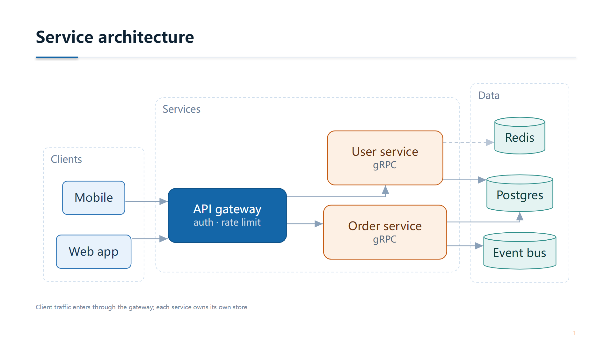
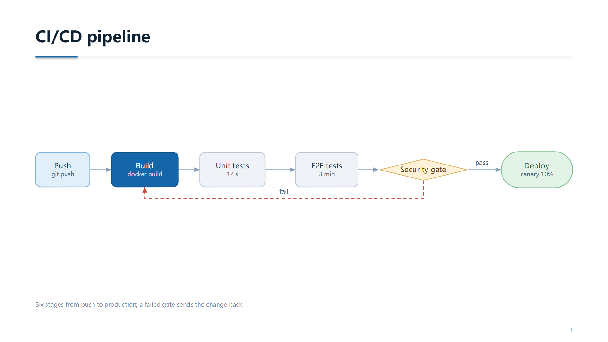
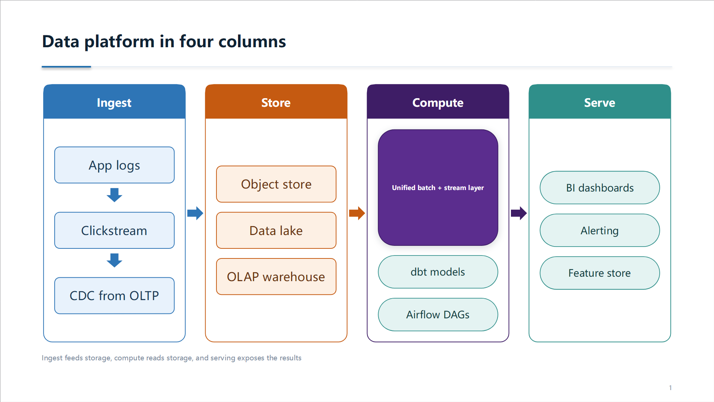
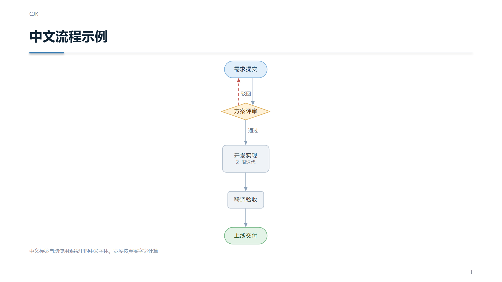

# ppt-diagram

给 AI 用的“画图”能力：**一段 JSON 进去，一个可编辑的 PPT 出来**。
里面的框、箭头、文字都是 PowerPoint 原生形状，不是贴上去的图片——打开就能改字、改色、拖位置。



## 它解决什么

| | 常规做法（贴图） | 这里（native） |
|---|---|---|
| 产物 | 一张 PNG/EMF | 一堆 `<p:sp>` 形状 |
| 改一个词 | 回原工具重出图 | 双击直接改 |
| 换配色 | 重新生成 | 选中→改主题色 |
| 字体 | 冻结在图片里 | 跟随文档字体 |
| 放大 | 位图会糊 | 矢量，随 PPT 缩放 |

排版交给 **Graphviz**（分层、避让、正交布线），落图形交给 **python-pptx**。
两者之间的坐标换算、缩放、配色、标签避让，都在 `scripts/dot2pptx/` 里。

## 三种版式

| 版式 | 适用 | 示例 |
|---|---|---|
| **graph**（默认） | 流程、判断分支、网络、带环的图 | `examples/pipeline.json` `examples/architecture.json` |
| **layers** | 等宽分层：输入 → 方法 → 融合 → 输出 | — |
| **panels** | 3–5 根高窄栏，每栏自己排内容 | `examples/panels.json` |

`graph` 由 Graphviz 算坐标；`layers` / `panels` 是我自己的网格排版（等宽、箭头居中对齐，Graphviz 做不整齐）。





中文标签自动走系统里的中文字体（Windows 雅黑 / macOS PingFang / Linux Noto），字宽按真实字体测量，不会溢出：



## 安装

这是一个 **agent skill**：把它放进 agent 扫描的目录之一，重启会话就会被自动发现。

| 作用域 | 路径 |
|---|---|
| 用户全局 | `~/.dsh/skills/ppt-diagram` |
| 用户全局（兼容） | `~/.agents/skills/ppt-diagram` |
| 当前项目 | `<项目>/.dsh/skills/ppt-diagram` |
| 当前项目（兼容） | `<项目>/.agents/skills/ppt-diagram` |

一行安装（skill 没有包管理器，`git clone` 到正确位置就是安装）：

```bash
git clone https://github.com/C1jian6/ai-ppt-diagram-skill.git ~/.dsh/skills/dot2pptx
```

或者用仓库里的脚本（会顺带做一次环境自检）：

```powershell
.\install.ps1                      # Windows
```
```bash
bash install.sh                    # macOS / Linux
```

> 只想当命令行工具用？不需要安装，直接 `python scripts/draw.py ...`。

## 用法

### 你（使用者）

说一句话就行：

> 「画个 CI/CD 流水线」　「把这张表画成四栏对比图」　「架构图改成左右两栏」

下面这些是**我做**的，你不用敲：

### 我（执行）

```bash
# 1. 环境自检（首次或换电脑时）
python scripts/bootstrap.py --check

# 2. JSON → pptx
python scripts/draw.py examples/pipeline.json -o out/pipeline.pptx

# 3. 渲染自查（生成后必须看一眼）
python scripts/draw.py ... && <libreoffice> render --input out/pipeline.pptx --output-dir tmp/
```

常用参数：

| 参数 | 说明 |
|---|---|
| `--mode native` | 默认，出可编辑形状 |
| `--mode image` | 出 EMF/PNG 图片，适合节点特别密的图 |
| `--theme ocean/forest/sunset/ink/tech` | 配色 |
| `--size 16:9 / 4:3` | 画布 |
| `--no-chrome` | 不要标题、分隔线、图注、页码 |

## 目录

```
ppt-diagram/
├─ SKILL.md              # 给 AI 的作业指导：选哪种布局、五步流程、硬规则
├─ references/spec.md    # JSON 字段全表
├─ scripts/
│  ├─ bootstrap.py       # 依赖自检（dot / python-pptx / 中文字体）
│  ├─ draw.py            # 唯一入口
│  └─ dot2pptx/          # 引擎
└─ examples/             # 4 个可直接跑的模板
```

## JSON 速查

最小示例（`graph` 版式）：

```json
{
  "title": "Deploy flow",
  "direction": "LR",
  "nodes": {
    "a": {"label": "Build", "tone": "primary", "sub": "docker"},
    "b": {"label": "Ship", "shape": "stadium", "tone": "success"}
  },
  "edges": [{"from": "a", "to": "b", "label": "ok"}]
}
```

字段要点（完整表见 `references/spec.md`）：

| 对象 | 关键字段 |
|---|---|
| 节点 | `label` `sub` `badge` `bullets` `shape` `tone` `width/height` `shadow` |
| 连线 | `label` `style(dashed/dotted/bold)` `tone` `arrow` `constraint` |
| 分组 | `clusters: [{label, nodes}]`、`ranks: [[...]]` |
| 配色 | `tones: {name: {fill, stroke, font}}`，全图统一语义色 |
| 版式 | `layout: "layers" \| "panels"` |

## 依赖与自检

| 依赖 | 必需 | 说明 |
|---|---|---|
| Graphviz（`dot`） | `graph` 版式必需 | `layers` / `panels` 不需要 |
| python-pptx | 必需 | 写 OOXML |
| Pillow | 必需 | 量字宽 |
| 中文字体 | 可选 | 没有就只影响中文渲染 |

```bash
$ python scripts/bootstrap.py --check
[ok  ] python       3.12.14
[ok  ] graphviz     C:\Program Files\Graphviz\bin\dot.exe
[ok  ] python-pptx
[ok  ] pillow
[ok  ] cjk-font     Microsoft YaHei (C:\Windows\Fonts\msyh.ttc)

status: ready
```

缺什么会直接给可复制的安装命令；字体可以用 `DOT2PPTX_FONT` / `DOT2PPTX_FONT_FILE` 指定。

## 已知限制

- **布局是冻结的**：生成后拖动一个节点，连线不会跟着走（箭头是独立形状，不是 Office 连接符）。
- 只画折线/正交线，没有贝塞尔曲线。
- 节点超过 ~30 个时 Graphviz 的排版会拥挤，建议拆成多页。
- 图片模式（`--mode image`）需要 Graphviz 渲染，且文字不可编辑。
- 视觉自查依赖 LibreOffice；没有的话会明确标注“未做视觉校验”，不会假装看过。

## 排错

| 症状 | 原因 | 处理 |
|---|---|---|
| `Graphviz dot was not found` | 没装或不在 PATH | 按提示 `winget/brew/apt install graphviz`，或设 `DOT2PPTX_DOT` |
| 中文变成方块/宋体 | 系统无中文字体 | 装字体，或 `DOT2PPTX_FONT="Noto Sans CJK SC"` |
| `[warn] labels end up at 8 pt` | 图太大被缩得太小 | 换布局或拆图，别硬塞 |
| 文字溢出框 | 标签太长 | 缩短 `label`，细节挪到 `sub` |
| 输出里没有图片模式 | `--mode` 写错 | 图片用 `--mode image --vector png` |

## 版本

0.1.0 —— 能画、能改、能自查。缺自动化测试和全局安装（见下）。
